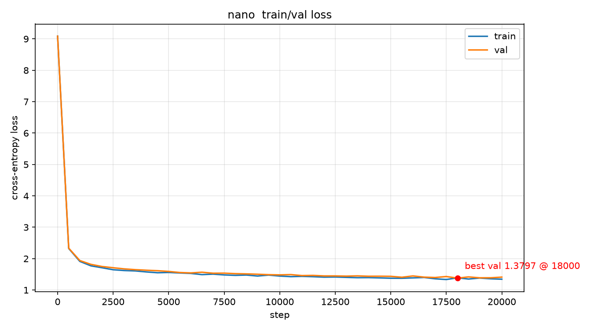
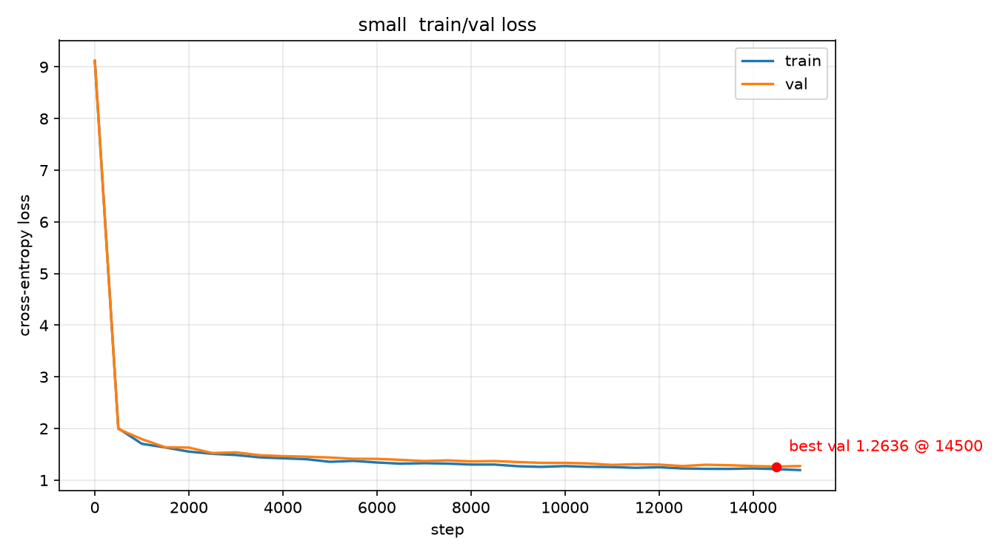
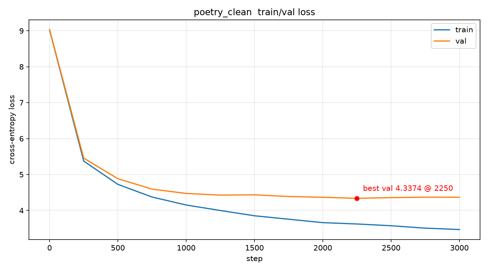

# 从零手搓 LLM · 在 8GB 笔记本上训练语言模型

> **不依赖 `transformers`**，从零实现 Llama 架构（RMSNorm / RoPE / GQA / SwiGLU / KV Cache）
> 与完整训练链路，在 **RTX 5060 Laptop 8GB** 上训出 **3 个模型 + 1 个 LoRA 助手**。
> 所有指标均为实测，可一键复现。

---

## 结果一览

| 模型 | 参数量 | 语料 | 验证集 loss | PPL | 耗时 |
|---|---|---|---|---|---|
| **nano** · 英文故事 | 12.88M | 4.64 亿 token | 9.09 → **1.3797** | **3.97** | 2.77 h |
| **small** · 英文放大版 | **50.72M** | 9.83 亿 token | 9.12 → **1.2636** | **3.54** | ~6.9 h |
| **poetry** · 中文古诗 | 5.00M | 0.98 亿 token | → **4.3374** | 76.51 | 8 min |
| **LoRA 助手** · Qwen2.5-0.5B | 8.8M 可训练（**1.75%**） | 40 条中文指令 | — | — | 15 s |

> 三个自训模型各自独立 tokenizer，权重不可互换。

### loss 曲线（train / val 同步下降，无过拟合）

| nano（12.88M） | small（50.72M） | poetry（5.00M） |
|---|---|---|
|  |  |  |

---

## 生成样例

**英文（small，prompt = `Once upon a time`）**
> Once upon a time, there was a little girl named Lily. She had a big wardrobe in her room that was white and cozy. One day, she wanted to play a game with her friend, Timmy. Lily said, "Let's play hide-and-seek!" Timmy replied, "Okay, but I want to go outside instead. It looks cold."

**中文古诗（poetry，prompt = `春眠不觉晓`）**
> 春眠不觉晓，一呌還聞唱竹枝。一曲弦橫吹者語，不知誰是舊知音。
> 《傷馬》牛嶠 —— 一陣金瘡即眼明，三邊猶用恨肝腸。

> 输出为**繁体**（语料是繁体），能写出五言/七言并自动带 `《标题》作者`，署名多为真实诗人。

**LoRA 微调对比（Qwen2.5-0.5B，20 条留出指令，人工判分「切题且基本无事实错误」）**

| | 微调前 | 微调后（LoRA） |
|---|---|---|
| 「白日依山尽」下一句 | ❌ 夕阳无限好 | ✅ 黄河入海流 |
| 什么是「意象」 | ❌ 源自柏拉图哲学… | ✅ 融情于物、以象寄意的手法 |
| 通过率 | **5/20** | **10/20** |

> 诚实结论：40 条数据的小样本 SFT **主要改回答风格**（更简洁、结构化），准确性提升有限。

---

## 从零实现了什么

- **Llama 架构**（`code/model.py`）：Pre-Norm + RMSNorm、RoPE 旋转位置编码、GQA 分组查询注意力、
  SwiGLU 前馈、无 bias + 权重绑定、KV Cache 增量推理
- **数据管道**（`code/bpe.py` + `code/prepare_data.py`）：手写 byte-level BPE + memmap 二进制流，
  2GB 语料零拷贝随机采样
- **训练循环**（`code/train.py`）：bf16 混合精度 + 梯度累积 + warmup/cosine 衰减 + 梯度裁剪 +
  原子化 checkpoint 断点续训
- **评测**（`code/eval_report.py`）：解析日志画 loss 曲线 + 批量生成 + 指标摘要
- **微调**（`code/finetune_lora.py` + `code/app.py`）：LoRA（含 loss mask）+ Gradio 交互界面

---

## 快速开始

### 环境

| 项 | 值 |
|---|---|
| GPU | RTX 5060 Laptop **8GB sm_120 (Blackwell)** |
| torch | **2.11.0+cu128**（必须 cu128，否则 `no kernel image`） |
| 依赖 | numpy / tokenizers / datasets / matplotlib；微调另需 transformers / peft / accelerate / gradio |

```bash
python -m venv venv
venv/Scripts/python -m pip install torch --index-url https://download.pytorch.org/whl/cu128
venv/Scripts/python -m pip install numpy tokenizers datasets matplotlib
```

> **PyCharm**：解释器指到 `venv/Scripts/python.exe`；Run Configuration 里加
> `Environment variable: PYTHONUTF8=1`（否则中文输出会 GBK 报错）。

### 一键验证（改代码后必跑，约 40 秒，6 关全绿）

```bash
cd code && python smoke_test.py
```

### 复现完整流程

```bash
PY=venv/Scripts/python
CODE=handmade-llm/code

# 1) 数据：语料 → BPE + uint16 二进制流
$PY $CODE/prepare_data.py --mode hf --input corpus/TinyStories-train.txt \
    --out data/tinystories --vocab_size 8192

# 2) 预训练（nano 配置，约 2.8 小时）
$PY $CODE/train.py --data_dir data/tinystories --out_dir out/nano \
    --n_layer 6 --n_head 6 --n_embd 384 --n_kv_head 3 \
    --block_size 512 --batch_size 16 --grad_accum 8 --max_iters 20000

# 3) 评测：loss 曲线 + 20 条样例
$PY $CODE/eval_report.py --ckpt out/nano/ckpt_final.pt --data_dir data/tinystories \
    --log out/nano/train.log --out_dir out/nano

# 4) 推理
$PY $CODE/sample.py --ckpt out/nano/ckpt_final.pt --data_dir data/tinystories \
    --prompt "Once upon a time"

# 5) LoRA 微调 + Gradio demo
$PY $CODE/finetune_lora.py --model models/Qwen2.5-0.5B-Instruct \
    --data data/sft_data.jsonl --out out/lora
$PY $CODE/app.py --model models/Qwen2.5-0.5B-Instruct --adapter out/lora/adapter --port 7860
#   对比微调前：加 --no_lora
```

---

## 目录结构

```
handmade-llm/
├── README.md                    ← 本文件
├── 手搓LLM实施手册.md            ← 13 章原理与实操
├── PyTorch入门-从数学到代码.md
├── docs/                        ← loss 曲线图
└── code/
    ├── model.py                 · Llama 架构（RMSNorm/RoPE/GQA/SwiGLU/KV cache）
    ├── bpe.py                   · 教学用 byte-level BPE
    ├── prepare_data.py          · 语料 → uint16 二进制流
    ├── train.py                 · 预训练循环（bf16 + 梯度累积 + 断点续训）
    ├── sample.py                · 手写 KV cache 生成
    ├── eval_report.py           · 评测报告
    ├── clean_poetry.py          · 古诗语料清洗
    ├── finetune_lora.py         · LoRA 微调
    ├── app.py / theme.py        · Gradio 界面
    └── smoke_test.py            · 端到端冒烟测试
```

---

## 踩过的坑（详见实施手册）

1. **sm_120 必须 cu128** —— 否则 `no kernel image is available`。
2. **数据管道 OOM** —— 原实现用 Python list 累积 5 亿个 int（~17GB）必崩；
   改分批 `encode_batch` + 立即转 numpy uint16，降到 ~1GB。
3. **古诗模型过拟合** —— 12.8M 参数配 4.19M token，val 从 4.33 涨到 4.99；
   缩到 5.00M 后过拟合幅度 +0.67 → +0.06。
4. **显存悬崖** —— batch 超过阈值后吞吐断崖式下跌（batch 32 时掉到 12.9k tok/s），拐点在 batch 20。
5. **笔记本休眠** —— 长训练前 `powercfg /change standby-timeout-ac 0`，否则一夜只前进几百步。
6. **Gradio 6 暗色模式** —— 组件样式与主题变量不同步，需同时覆盖 `*_dark` 变体。

---

## 更多

- 原理与实操细节见 [`手搓LLM实施手册.md`](手搓LLM实施手册.md)（13 章）
- PyTorch 基础见 [`PyTorch入门-从数学到代码.md`](PyTorch入门-从数学到代码.md)
